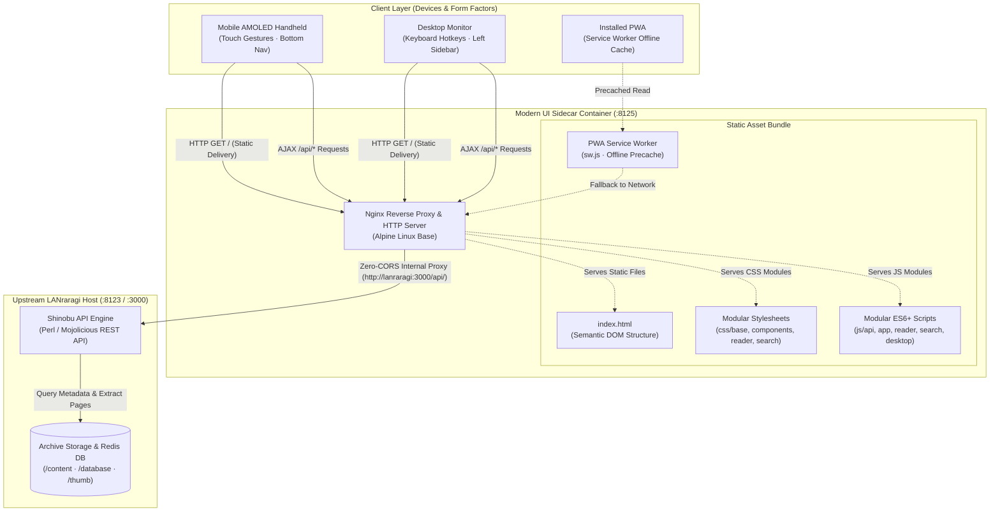

<div align="center" id="top">

# LANraragi Modern UI

### AMOLED Pure Black, Responsive Web Reader for LANraragi

A sleek, mobile-first and desktop-optimized web reader for LANraragi with true AMOLED pure black aesthetics, zero build tools, modular vanilla architecture, PWA offline caching, and instant Nginx sidecar deployment.

[](#tech-stack)
[](#tech-stack)
[](#tech-stack)
[](#quick-start-docker-sidecar)
[](#key-features)
[](LICENSE)

[Quick Start](#quick-start-docker-sidecar) · [Architecture](#architecture) · [Features](#key-features) · [Tech Stack](#tech-stack) · [Shortcuts](#desktop-shortcuts) · [Operations](#operations--service-lifecycle) · [Troubleshooting](#troubleshooting)

</div>

---

> Built for manga, manhwa, and comic readers who want a distraction-free, pure-black reading experience on mobile AMOLED displays and wide desktop monitors without heavy frontend frameworks or build steps.

---

## Architecture

LANraragi Modern UI is designed as a zero-build client layer running alongside your existing LANraragi container. The architecture decouples static presentation assets from upstream Perl business logic while completely eliminating Cross-Origin Resource Sharing (CORS) hurdles through an Nginx reverse-proxy sidecar.



### Architectural Principles

1. **Zero-Build Pipeline**: No Node.js build step, bundler (Vite/Webpack), or transpilation runtime required. Every CSS and JS file is native ES6+ loaded directly by the browser.
2. **Zero-CORS Proxying**: The client never initiates cross-origin requests to port 8123. Nginx transparently handles all `/api/` routing under the same origin.
3. **Storage & State Isolation**: Reader settings, zoom factors, and layout states persist in client-side `localStorage`, while archive read progress syncs seamlessly with LANraragi server metadata.

---

## Key Features

<table>
  <tr>
    <td width="50%" valign="top">
      <h4>📖 Reading Experience & UI Controls</h4>
      <ul>
        <li><strong>AMOLED Pure Black (<code>#000000</code>)</strong>: True-black theme designed for OLED displays, reducing power draw to zero on black pixels and preventing dark-room glare.</li>
        <li><strong>Adaptive Responsive Layout</strong>: Floating ergonomic bottom footbar for mobile one-handed reading; transforms into a sticky sidebar and top search bar on wide desktop viewports.</li>
        <li><strong>Seamless Dual-Page Spread</strong>: Automatic single-page or two-page spread rendering without unsightly center gaps, borders, or misalignment.</li>
        <li><strong>Native Reading Flows</strong>: Instant toggle between Right-to-Left (manga) and Left-to-Right (manhwa/comics) with matching touch swipe gestures.</li>
        <li><strong>Thumbnail Overview Drawer</strong>: Visual page navigation drawer with lazy-loaded thumbnails for immediate jumping to specific chapters or scenes.</li>
        <li><strong>Ergonomic Desktop Hotkeys</strong>: Full keyboard navigation for instant page turning (<code>J</code> / <code>K</code>), fullscreen (<code>F</code>), search jump, and modal dismissals.</li>
      </ul>
    </td>
    <td width="50%" valign="top">
      <h4>🗄️ Library, Metadata & Architecture</h4>
      <ul>
        <li><strong>Shinobu Tag Autocomplete</strong>: Real-time search engine suggestions across namespaces (<code>artist:</code>, <code>series:</code>, <code>character:</code>, <code>group:</code>) with color-coded count badges.</li>
        <li><strong>Taxonomy Explorer</strong>: Deep navigation tab organizing library archives by authors, characters, tags, or publishers with quick-filter capabilities.</li>
        <li><strong>Server-Synced Reading Progress</strong>: Automatic progress logging with resume indicators, history timeline view, and visual read badges on library cards.</li>
        <li><strong>Progressive Web App (PWA)</strong>: Full web app manifest and Service Worker (<code>sw.js</code>) caching core assets for near-instant boot times and offline asset resilience.</li>
        <li><strong>Modular Clean Architecture</strong>: Decomposed into atomic CSS and JavaScript modules adhering to strict anti-monolith file standards (< 300 lines per module).</li>
        <li><strong>Turnkey Nginx Sidecar</strong>: Pre-configured reverse proxy container eliminating CORS configuration headaches on your primary server.</li>
      </ul>
    </td>
  </tr>
</table>

---

## Tech Stack

| Layer | Technology | Purpose |
|---|---|---|
| **Frontend UI** | Semantic HTML5 | High-performance, lightweight DOM structure |
| **Styling** | Modular Native CSS | Decomposed component, grid, search, sidebar, and reader stylesheets |
| **Logic & State** | Modular Vanilla JavaScript (ES6+) | Modern async API client, search controller, reader state machine |
| **Offline & PWA** | Service Worker + Cache API | Asset precaching, home screen installability, and fast repeat boots |
| **Web Server / Proxy** | Nginx Alpine (Docker) | Low-footprint static web server and Zero-CORS upstream API proxy |
| **Backend Core** | LANraragi (Mojolicious / Perl) | Upstream content management, archive extraction, and metadata DB |

---

## Quick Start (Docker Sidecar)

The recommended deployment runs LANraragi Modern UI as an Nginx sidecar container attached to the same Docker network as your primary LANraragi server.

### Prerequisites

- Docker Engine 24.0+ & Docker Compose v2.0+
- Running instance of LANraragi (v0.8.0 or newer)
- Port `8125` available on host (or adjust port binding as needed)

### `docker-compose.yml`

```yaml
services:
  # Existing LANraragi backend server
  lanraragi:
    image: difegue/lanraragi:latest
    container_name: lanraragi
    restart: unless-stopped
    ports:
      - "8123:3000"
    volumes:
      - /mnt/manga/content:/home/koyomi/lanraragi/content:ro
      - ./database:/home/koyomi/lanraragi/database
      - ./thumb:/home/koyomi/lanraragi/thumb

  # LANraragi Modern UI Sidecar
  lanraragi-web:
    image: nginx:alpine
    container_name: lanraragi-web
    restart: unless-stopped
    ports:
      - "8125:80"
    volumes:
      - ./index.html:/usr/share/nginx/html/index.html:ro
      - ./css:/usr/share/nginx/html/css:ro
      - ./js:/usr/share/nginx/html/js:ro
      - ./sw.js:/usr/share/nginx/html/sw.js:ro
      - ./manifest.json:/usr/share/nginx/html/manifest.json:ro
      - ./nginx.conf:/etc/nginx/conf.d/default.conf:ro
    depends_on:
      - lanraragi
```

### Installation in 4 Steps

```bash
# 1. Clone this repository into your LANraragi directory
git clone https://github.com/samsmon/lanraragi-modern-ui.git
cd lanraragi-modern-ui

# 2. Configure volumes in docker-compose.yml to match your archive paths
# Ensure the service name matches upstream 'lanraragi' in nginx.conf

# 3. Start containers in detached mode
docker compose up -d

# 4. Verify deployment health
docker compose ps
```

The application is now accessible at `http://<your-server-ip>:8125`. Your original LANraragi admin interface remains accessible on `http://<your-server-ip>:8123`.

---

## Desktop Shortcuts

| Key | Scope | Action |
|---|---|---|
| <kbd>J</kbd> or <kbd>→</kbd> | Reader | Turn to next page (or previous in RTL mode) |
| <kbd>K</kbd> or <kbd>←</kbd> | Reader | Turn to previous page (or next in RTL mode) |
| <kbd>F</kbd> | Reader | Toggle browser fullscreen mode |
| <kbd>M</kbd> | Reader | Toggle Single Page / Double Page spread mode |
| <kbd>Esc</kbd> | Global | Close reader modal, dismiss archive detail drawer, or clear search |
| <kbd>/</kbd> or <kbd>Ctrl</kbd> + <kbd>K</kbd> | Global | Instant focus on the search input bar |
| <kbd>1</kbd> / <kbd>2</kbd> / <kbd>3</kbd> | Global | Fast view switching: `1` Library · `2` Explore · `3` History |
| <kbd>R</kbd> | Global | Open details drawer for a random archive |

---

## Operations & Service Lifecycle

### Reloading UI Without Container Restart

Because static directories (`css/`, `js/`, `index.html`) are mounted as read-only volumes, code changes take effect immediately on file save without restarting the container:

```bash
# Force browser cache bypass to test changes
curl -I http://localhost:8125/js/app.js

# Restart only the Nginx sidecar container if nginx.conf was edited
docker compose restart lanraragi-web

# Follow sidecar access and error logs live
docker compose logs -f lanraragi-web
```

---

## Troubleshooting

| Symptom | Probable Cause | Immediate Remediation |
|---|---|---|
| **502 Bad Gateway on `/api/*`** | Backend offline or container network mismatch | Verify `lanraragi` is running via `docker compose ps`. Confirm both containers are attached to the same Docker bridge network. |
| **Stale UI / Code Not Updating** | PWA Service Worker cached old assets | Hard refresh using <kbd>Ctrl</kbd> + <kbd>F5</kbd>, or unregister `sw.js` via DevTools (`Application` → `Service Workers` → `Unregister`). |
| **Missing Cover Thumbnails** | LANraragi thumbnail generation in progress | Ensure `./thumb` volume is mounted properly and check LANraragi's background task queue in the admin panel. |
| **CORS Errors in Console** | Accessing backend port directly | Always connect through port `8125` (Nginx sidecar) rather than the direct backend port `8123`. |

---

## Known Limits & Backlog

- **Upstream Version**: Requires LANraragi v0.8.0+ for modern JSON response structures and Shinobu endpoints.
- **Search Dependency**: Tag auto-completion relies on the server's internal Shinobu engine; search syntax matches LANraragi documentation.
- **Ultra-High Resolution Archives**: Spreads containing uncompressed 4K+ images rely on client GPU decoding memory in dual-page mode.

---

## License & Acknowledgements

Distributed under the [MIT License](LICENSE) © [samsmon](https://github.com/samsmon).

- Upstream server and API engine powered by [LANraragi](https://github.com/Difegue/LANraragi) by Difegue.
- Clean vector interface iconography provided by [Tabler Icons](https://tabler-icons.io/).

<div align="right"><a href="#top">Back to top ↑</a></div>
